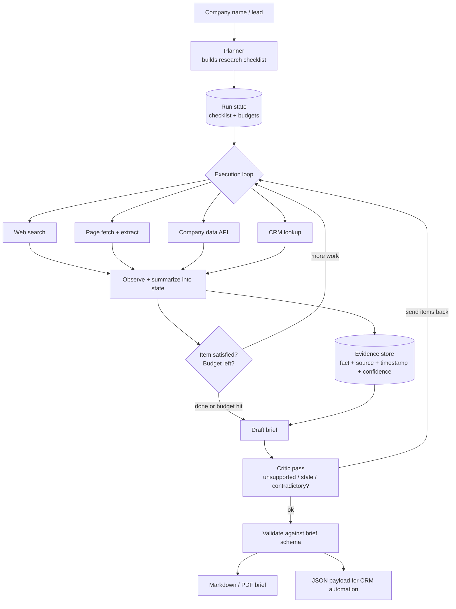

# 🕵️ Sales Research Agent

**Give it a company or a lead, and it autonomously builds a sourced research brief a sales rep can act on, where every fact links back to where it came from.**

  

> 🚧 **This project is in the design phase.** This README documents the problem, planned architecture, and tradeoffs. Progress is tracked in the [Roadmap](#-roadmap), and measured results will be added to the [Design Log](#-design-log) as each phase ships.

---

## 📌 The Problem

Before every sales call, someone has to research the prospect: funding history, headcount trend, tech stack, recent announcements, leadership changes, likely pain points. It's:

- **Expensive** – 20 to 45 minutes of a rep's time per account
- **Repetitive** – the same checklist, every time
- **Inconsistent** – quality depends on who did it and how busy they were

Naive "ask a chatbot about Company X" doesn't solve it either: models confidently invent funding rounds and executives that don't exist.

## 💡 The Solution

A multi-step agent that **plans** a research checklist, **uses tools** (search, page extraction, company data, CRM lookup) to fill it, **stores evidence** with a source for every fact, runs a **critic pass** to catch unsupported claims, and outputs a **structured brief**.

It's also honest about the hardest agent problem: **knowing when to stop**. Every run has hard budgets on steps, tokens, time, and cost.

### Planned capabilities
- Explicit research plan held as state (not buried in chat history)
- Typed, validated tool outputs
- Parallel research of independent checklist items
- Evidence store: every fact has a source URL, timestamp, and confidence
- Critic pass that sends weak items back for another round
- Graceful degradation when tools fail
- Full run replay and step-by-step trace viewer

---

## 🏗️ Architecture



### Flow
1. **Plan** – turn the objective into an explicit checklist (snapshot, funding, headcount, tech stack, news, stakeholders, pain hypotheses).
2. **Act** – pick a tool for the next open item; independent items run in parallel.
3. **Observe** – validate the tool output, summarize it into state, and write facts to the evidence store with their source.
4. **Check** – is this item satisfied? Is any budget (steps, tokens, time, dollars) exhausted?
5. **Draft** – assemble a brief using only facts that exist in the evidence store.
6. **Critique** – a second model flags unsupported, stale, or contradictory claims and can send specific items back.
7. **Deliver** – validate against a schema, render a human brief, and emit JSON for the automation pipeline.

---

## 🧰 Tech Stack (planned)

| Layer | Choice | Why |
|---|---|---|
| Orchestration | Plain Python async loop first | Understand the loop before adopting a framework; move to LangGraph only if durable branching is needed |
| Tools | Search API, extraction/headless browser, one company data provider, CRM client | Covers static pages, JS-heavy pages, structured data |
| Schemas | Pydantic | Typed tool outputs and brief contract |
| State | Postgres (runs, steps, evidence, artifacts) | Every run is replayable |
| Concurrency | asyncio fan-out + per-domain rate limiter | Faster runs without getting blocked |
| Output | Markdown/PDF + JSON | Humans read one, the CRM pipeline consumes the other |

---

## ⚖️ Key Design Decisions & Tradeoffs

| Decision | Chosen | Alternative | Tradeoff |
|---|---|---|---|
| Orchestration | Hand-written loop | Agent framework from day one | Slower start, but I can debug every step and explain it |
| Plan storage | Explicit state object | Implicit in chat history | More code, but avoids context rot and makes progress inspectable |
| Grounding | Evidence store + critic | "Please don't hallucinate" in the prompt | Extra calls and cost, but a structural fix instead of a hope |
| Stopping | Hard budgets + per-item satisfaction checks | Let the model decide | Occasionally stops early, but never spirals or overspends |
| Tool failures | Degrade and report gaps | Fail the run | Brief may be incomplete, but it's honest about what wasn't verified |
| Sources | Allowlist with quality tiers | Any search result | Misses some niche sources, filters SEO spam |

---

## 🧗 Hard Problems I'm Planning For

- **Knowing when to stop** – agents quit too early or loop forever. → Hard caps on steps, tokens, wall-clock, dollars + explicit satisfaction checks.
- **Context rot** – appending every tool result buries the objective. → Summarize into state; re-inject the objective every turn.
- **The hostile open web** – paywalls, bot walls, rate limits, spam. → Treat scraping failure as normal; tiered source allowlist.
- **Confident fabrication** – a plausible funding round that never happened. → No fact enters the brief without a source row.
- **Non-determinism** – same input, different paths. → Log seeds, model versions, and prompt versions per run.

---

## 📏 How I'll Measure It

All values are **targets**.

| Metric | What it tells me | Target |
|---|---|---|
| Task success rate | % of briefs passing a human rubric | ≥ 80% on a fixed company set |
| Groundedness | % of claims with a valid, live, on-topic source | ≥ 95% |
| Efficiency | Median steps, tokens, and $ per brief | Reported per run; cost ceiling enforced |
| Recovery rate | % of runs that hit a tool failure and still complete | ≥ 90% |

---

## 🗺️ Roadmap

- [ ] **Phase 1 – Single loop:** search + fetch, fixed checklist, no planning; sourced brief for a well-known company
- [ ] **Phase 2 – Planning:** planner, typed tool schemas, per-step retry with backoff; failed tools degrade instead of killing the run
- [ ] **Phase 3 – Grounding:** evidence store + citation enforcement; every sentence traces to a stored source
- [ ] **Phase 4 – Control:** critic pass, step budget, cost ceiling; runs terminate predictably
- [ ] **Phase 5 – Replay:** full run replay + step-by-step trace viewer

**Stretch:** human approval before any outbound action · scheduled re-runs that show only what changed · learned source-quality weights

### Non-goals (for now)
- Sending emails or messages to prospects
- Scraping sites that prohibit it or sit behind logins
- Personal profiling of private individuals beyond public professional info

---

## 📁 Planned Repo Structure

```
sales-research-agent/
├── agent/
│   ├── planner/      # checklist generation
│   ├── loop/         # execution loop, budgets, stopping logic
│   ├── tools/        # search, fetch, company data, CRM (typed)
│   ├── evidence/     # evidence store models + queries
│   ├── critic/       # review pass
│   └── brief/        # schema + renderers (md/pdf/json)
├── replay/           # run replay + trace viewer
├── evals/            # rubric + company set (run by llm-eval-bench)
├── docs/decisions/
└── tests/
```

---

## 🔗 Part of a Larger System

This is **layer 3 (Agents)**.

| Layer | Repo |
|---|---|
| Retrieval | [codebase-copilot](https://github.com/khushi0101/codebase-copilot) |
| Evals | [llm-eval-bench](https://github.com/khushi0101/llm-eval-bench) – scores brief quality and groundedness |
| Agents | **sales-research-agent** (you are here) |
| Automation | [lead-to-crm-automation](https://github.com/khushi0101/lead-to-crm-automation) – calls this agent for enrichment |
| Observability | [ai-production-monitor](https://github.com/khushi0101/ai-production-monitor) – traces each step |
| Guardrails | [ai-safety-gateway](https://github.com/khushi0101/ai-safety-gateway) – screens fetched pages for prompt injection |

---

## 🎬 Planned Demo

Run it live on a company the viewer picks while the trace viewer streams each step. Open the brief and click a citation. Then kill a tool mid-run and show the agent degrading gracefully and reporting what it couldn't verify.

---

## 🚀 Getting Started

*Coming with Phase 1.*

---

## 📓 Design Log

| Date | Change | Metric | Before → After | Decision |
|---|---|---|---|---|
| – | – | – | – | – |

---

## 👩‍💻 Author

**Khushi Agrawal** · [GitHub](https://github.com/khushi0101) · [LinkedIn](https://linkedin.com/in/khushi--agrawal)
